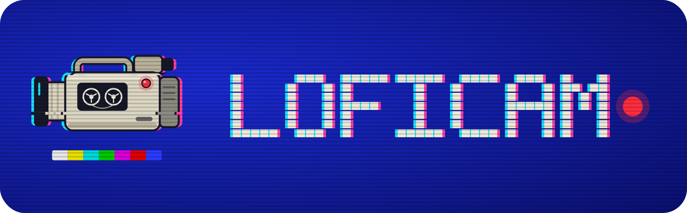
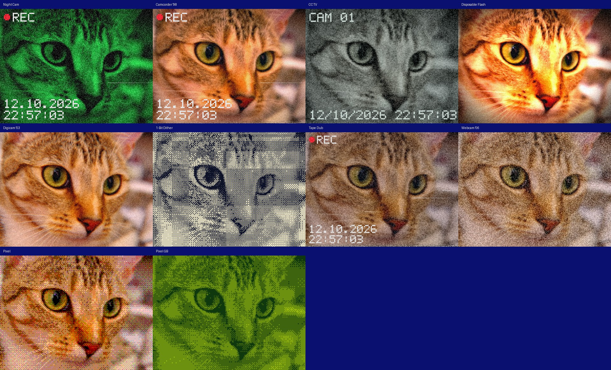

<p align="center"></p>

# LoFiCam

A retro camera app for Android. It applies lo-fi looks (night-vision, camcorder tape, CCTV, disposable flash,
CCD digicam, 1-bit dither) **live** while you shoot, so what you see in the viewfinder is what gets saved.

> **Status: Phase 1 (photo MVP).** Live preview with eight looks, a "Wear" slider, photo capture to
> `Pictures/LoFiCam`, front/back camera. Video recording, import/re-look and the look editor are next
> (see the [roadmap](docs/DESIGN.md#roadmap)). **Not yet run on a physical device**: CI proves it builds and the
> shader/logic tests pass; the first on-device run is the Phase 0 gate. See [Testing](#testing).

`LoFiCam` is a placeholder name.

## The looks

Rendered by the real shaders (the same GLSL files the app ships) on a test photo:



## How it works

```
camera (CameraX Preview) -> OES texture
   ingest   rotate / mirror / centre-crop / downscale to the look's virtual resolution (e.g. 480x360)
   stage 1  analog: tape jitter, lens softness, chromatic aberration, chroma bleed, tone, bloom, vignette,
            night vision, burned-in HUD, ghosting  -> also the temporal history
   stage 2  digital: head-switch noise, dropouts, grain, scanlines, quantise + ordered dither, palette
   present  upscale (nearest or linear) to the screen or to the export size
```

* A **look** is a JSON file (`render-core/src/main/assets/looks/`). It only sets parameters from a fixed registry
  (`params.json`) and defines macros such as "Wear"; it can never carry shader code.
* All effect sizes are in *virtual pixels*, so preview, photo export and (later) video look identical.
* Photo capture renders the final frame again at the look's export scale and reads it back, so the saved image
  matches the preview exactly, including the upscale filter.

Details: [docs/DESIGN.md](docs/DESIGN.md) and [docs/adr](docs/adr).

## Repo layout

| Path | What |
|---|---|
| `app/` | Compose UI, CameraX binding, view model, MediaStore saving |
| `render-core/` | GL pipeline, look parser, overlay painter, logging, **shaders and looks (assets)** |
| `tools/golden/` | Headless renderer + golden check for the shaders (Python + moderngl) |
| `tools/branding/` | Generator for the logo files in `docs/branding/` |
| `docs/` | Design doc, ADRs, golden images (`docs/looks`), branding |

## Build

Needs JDK 17 and the Android SDK (or just use the CI artifact).

```bash
./gradlew :render-core:testDebugUnitTest   # unit tests
./gradlew :app:assembleDebug               # app/build/outputs/apk/debug/app-debug.apk
```

Once the workflow is active (see [tools/ci](tools/ci/README.md)), every push builds a debug APK in GitHub Actions: open the run, download the **LoFiCam-debug-apk** artifact.

## Testing

| Layer | How | Where |
|---|---|---|
| Look parsing, macros, validation, overlay, camera-rotation maths, shader/registry consistency | JUnit | `render-core/src/test`, CI `android` job |
| Shader output | Render all looks headlessly with Mesa and compare with `docs/looks/*.jpg` | `python tools/golden/render_golden.py --check`, CI `shaders` job |
| Camera, GL setup, saving, performance | **On a real phone only** | Phase 0 checklist in `docs/DESIGN.md` |

After changing a shader or a look: `python tools/golden/render_golden.py --update`, look at `docs/looks/sheet.jpg`,
commit the new images. The golden check is deliberately blind to pure grain tweaks (it compares 4x-downsampled
images), so also eyeball the sheet.

## Logs

The app writes `files/logs/lofi-log.jsonl` (size-capped, rolling) with GL info, camera events, perf
(fps / CPU ms every 150 frames), shader or framebuffer errors and uncaught crashes. Errors that matter are also
shown on screen. In-app log export is on the roadmap.

## Contributing workflow

Short-lived branches and PRs, [Conventional Commits](https://www.conventionalcommits.org/), design decisions as
ADRs in `docs/adr`.
